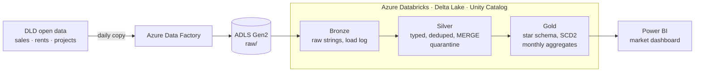
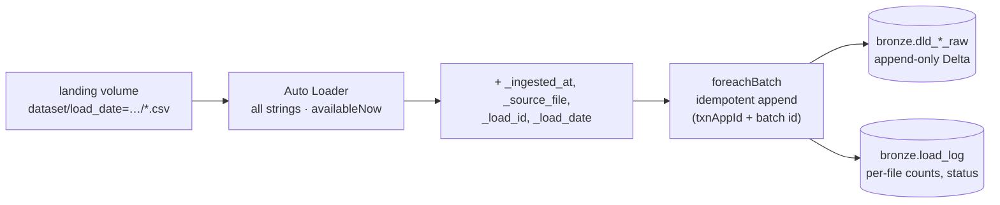
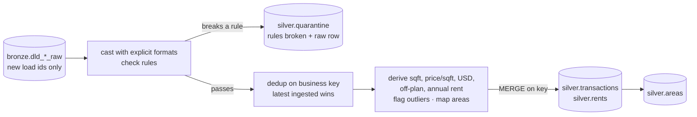
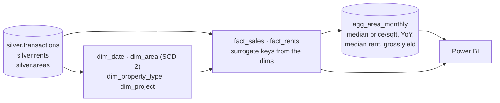
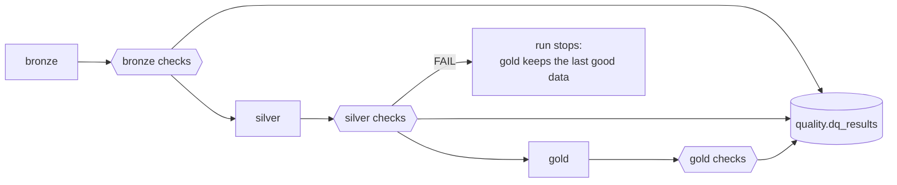

# Dubai Property Data Platform

[](https://github.com/salmantariq596/dubai-property-data-platform/actions/workflows/ci.yml)

An Azure lakehouse that turns official Dubai Land Department (DLD) sales and rental records into a market dashboard.

**The question it answers:** *Where in Dubai are prices rising fastest, what does a square foot cost by area and property type, and what rental yield can an investor expect?*

> 🚧 **Status: Module 6 of 10 — Power BI dashboard (report built; waiting for real data).** The platform is built in modules, each merged by pull request and tagged. See the [roadmap](#roadmap) and [CHANGELOG](CHANGELOG.md).

## Architecture



Data quality checks run between every layer. Terraform builds the infrastructure, Key Vault holds secrets, and GitHub Actions tests and deploys the code.

## Tech stack

| Layer | Tool | Why |
|---|---|---|
| Storage | Azure Data Lake Storage Gen2 | Standard Azure lake storage |
| Ingestion and scheduling | Azure Data Factory | Most-listed orchestration tool in Gulf data roles |
| Processing | Azure Databricks, PySpark | Distributed processing of 11M+ records |
| Table format | Delta Lake | ACID, MERGE, schema enforcement, time travel |
| Governance | Unity Catalog | Catalogs, permissions, lineage |
| Data quality | Custom rules + `dq_results` table | Bad data is quarantined or blocks the run |
| BI | Power BI | Dominant BI tool in the region |
| Infrastructure as code | Terraform | Whole platform rebuildable from code |
| CI/CD | GitHub Actions, Databricks Asset Bundles | Tested, automated deploys |

## Bronze: load every file exactly once



- **Re-runs are safe.** Auto Loader's checkpoint skips files already loaded, and idempotent writes cover a crash between writing and checkpointing.
- **Nothing is changed or lost.** Every column stays a string, `delta.appendOnly` blocks deletes and updates, and malformed values go to `_rescued_data`.
- **Every run is accounted for.** Each file is counted back after writing; empty and failed runs are logged too.

Design reasoning: [ADR 0002](docs/adr/0002-bronze-ingestion-design.md). Operations: [bronze runbook](docs/runbook_bronze.md).

## Silver: typed, trustworthy, one row per key



- **Bad data is kept, not lost.** A row that fails a cast or a rule goes to `silver.quarantine` with the rules it broke and its raw values.
- **Outliers are flagged, not deleted.** Zero sizes and prices per sqft outside 100–20,000 AED stay in silver with `outlier_reason`.
- **One area, one name.** English, Arabic and misspelled area names map to one `area_key`; Arabic-only rows get their English name.
- **Re-runs are safe.** Only new bronze loads are processed, and MERGE on the business key means a repeat changes nothing and old data never overwrites newer data.

Design reasoning: [ADR 0003](docs/adr/0003-silver-cleaning-design.md). Operations: [silver runbook](docs/runbook_silver.md).

## Gold: a star schema for Power BI



- **Clear grain.** `fact_sales` is one registered sale, `fact_rents` one Ejari contract; `agg_area_monthly` is one area × property type × month.
- **History kept.** `dim_area` is SCD Type 2: a sale keeps the area name it had on its date, and the aggregate reports today's name.
- **No lost rows.** Missing areas, types or projects point at an Unknown row (`-1`).
- **Yield you can trust.** Gross yield is published only when both medians rest on at least 10 records; outliers and multi-unit contracts are left out of medians.

Model diagram, grains and measures: [gold model](docs/gold_model.md). Design reasoning: [ADR 0004](docs/adr/0004-gold-star-schema.md). Timings: [performance](docs/performance.md).

## Data quality: bad data stops before the dashboard



- **The right response for each problem.** A bad row is quarantined in silver. Something odd but usable is a WARN. Anything that would make the next layer wrong is a FAIL and stops the run.
- **25 checks, each one SQL query** with WARN and FAIL thresholds: keys, dates, positive values, quarantine rate, row-count change against the previous load, gold reconciliation with silver, dimension integrity.
- **Every result recorded** in `dq_results`, before anything fails: rule, table, rows checked and failed, load id.
- **Tested end to end.** Integration tests run bronze to gold on both fixtures, and prove that a mostly broken load is stopped at silver with gold untouched.

Rule catalogue and what to do when a check fails: [data quality](docs/data_quality.md). Design reasoning: [ADR 0005](docs/adr/0005-data-quality.md).

## Dashboard

Four pages in Power BI: Market overview, Area deep-dive, Off-plan vs ready, Rental yield. The semantic model is code (TMDL), tested against gold in CI so a gold change cannot silently break the report. One parameter switches between a Databricks SQL warehouse and exported Parquet files.

Page designs: [dashboard](docs/dashboard.md). Setup: [powerbi/](powerbi/README.md). Design reasoning: [ADR 0006](docs/adr/0006-power-bi-model.md). *Screenshots follow once real data is loaded; until then the report runs on synthetic sample data (`tools/make_sample_gold.py`).*

## Repository layout

```
├── src/dubai_property/   # all pipeline logic, unit-tested
│   ├── profiling/        # Module 1: data discovery
│   ├── bronze/           # Module 2: Auto Loader ingestion, load log
│   ├── silver/           # Module 3: rules, cleaning, area mapping, MERGE
│   ├── gold/             # Module 4: star schema, SCD Type 2, monthly aggregate
│   ├── quality/          # Module 5: checks between layers, dq_results
│   ├── orchestrate.py    # the whole pipeline in one call
│   ├── config.py         # datasets, paths, table names
│   ├── utils/
├── notebooks/            # thin notebooks that call src/
├── tests/                # unit/, spark/, integration/, fixtures/
├── infra/                # Terraform
├── adf/                  # exported Data Factory pipelines
├── powerbi/              # semantic model (TMDL), theme, report and PDF export
└── docs/                 # data sources, dictionary, decisions, profiles
```

## Quick start

```bash
git clone https://github.com/salmantariq596/dubai-property-data-platform.git
cd dubai-property-data-platform
make setup          # virtualenv, dev dependencies, pre-commit hooks
make test-fast      # unit tests, no Spark needed
make setup-spark    # optional: local PySpark + Delta (Java 17+)
make test           # all tests, including Spark ingestion tests
make profile-sample # profile the synthetic fixture
```

Spark tests run in CI on every pull request. On Windows they are skipped locally (local Spark needs extra setup there); use WSL to run them.

**On Databricks:** clone the repo as a Git folder, run `notebooks/00_setup_unity_catalog`, upload a file to the landing volume, then run `notebooks/06_run_pipeline` (bronze, silver and gold with data quality checks between them). The layer notebooks `02`–`05` run one step each.

Profile a real DLD download:

```bash
dld-profile data/raw/transactions/load_date=2026-11-04/transactions.csv \
    --key transaction_id --output docs/profiles/transactions.md
```

Use `--sample-rows 200000` for a quick first look at a multi-gigabyte file.

## Data

Official DLD open data only; no listing sites are scraped. See [docs/data_sources.md](docs/data_sources.md) for sources and caveats, [docs/data_dictionary.md](docs/data_dictionary.md) for columns, and [docs/business_questions.md](docs/business_questions.md) for what the dashboard answers. Raw data is never committed.

## Roadmap

| Module | Scope | Status |
|---|---|---|
| 1 | Repo skeleton, data profiling, data dictionary, business questions | ✅ v0.1 |
| 2 | Bronze ingestion with Auto Loader and load log | ✅ v0.2 |
| 3 | Silver: typing, dedup, area mapping, MERGE, quarantine | ✅ v0.3 |
| 4 | Gold star schema, SCD Type 2, monthly aggregates, OPTIMIZE | ✅ v0.4 |
| 5 | Data quality framework and integration tests | ✅ v0.5 |
| 6 | Power BI dashboard (minimum complete version) | 🔧 report built; real data, PDF and insights to come |
| 7 | Azure infrastructure with Terraform | ⏳ |
| 8 | Data Factory orchestration, Asset Bundles | ⏳ |
| 9 | CI/CD deploy, monitoring, runbook, cost | ⏳ |
| 10 | Demo video and final write-up | ⏳ |

## Design decisions

Recorded as ADRs in [docs/adr/](docs/adr/). So far:

- [0001 — Develop locally and on Databricks Free Edition before Azure](docs/adr/0001-local-first-development.md)
- [0002 — Bronze ingestion: Auto Loader, idempotent foreachBatch, load log](docs/adr/0002-bronze-ingestion-design.md)
- [0003 — Silver cleaning: explicit casts, quarantine, MERGE on the business key](docs/adr/0003-silver-cleaning-design.md)
- [0004 — Gold star schema: hash surrogate keys, SCD Type 2 areas, full rebuilds](docs/adr/0004-gold-star-schema.md)
- [0005 — Data quality: checks between layers, dq_results, fail before the next layer](docs/adr/0005-data-quality.md)
- [0006 — Power BI model as code: import mode over gold, measures in DAX](docs/adr/0006-power-bi-model.md)

## License

MIT — see [LICENSE](LICENSE). DLD data is subject to the terms of its publisher.
