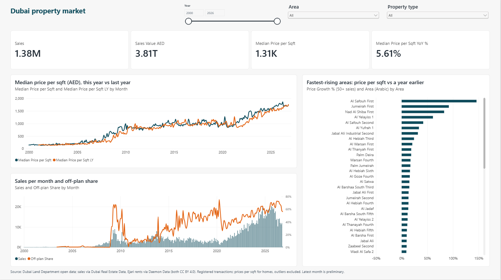
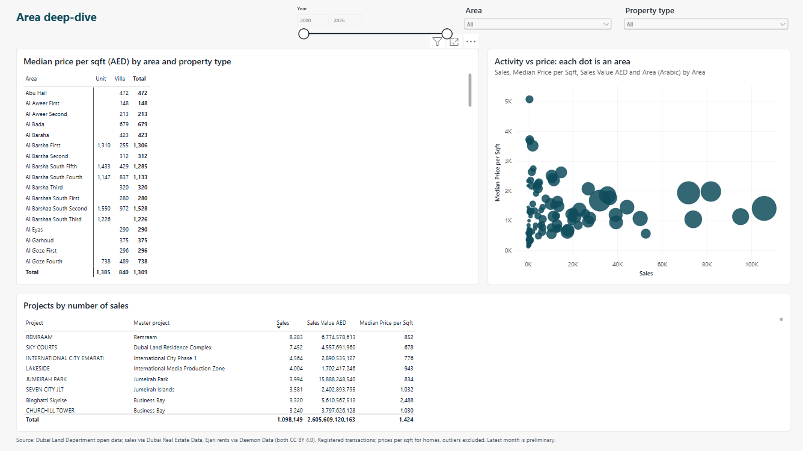
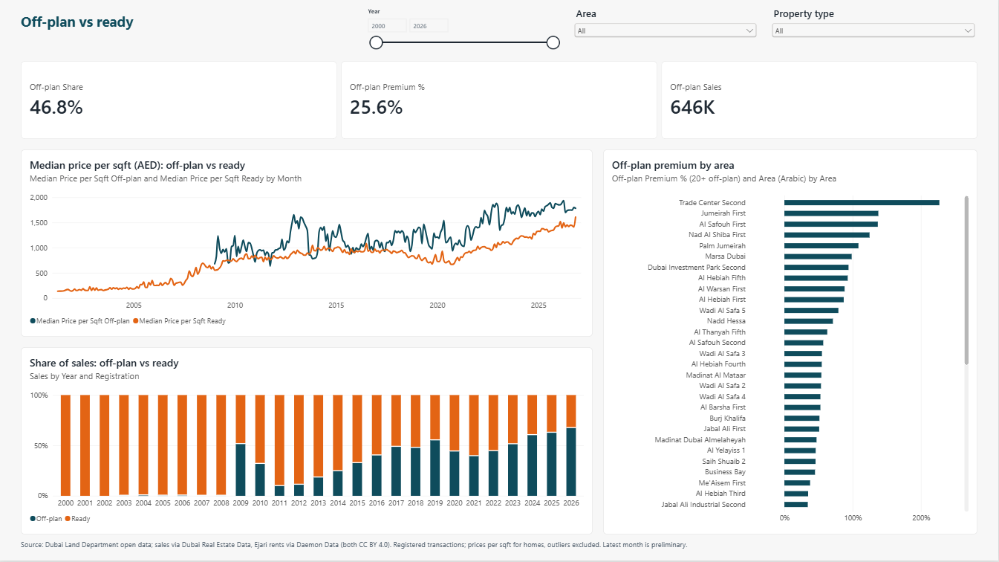
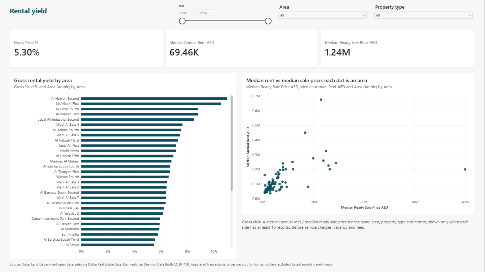
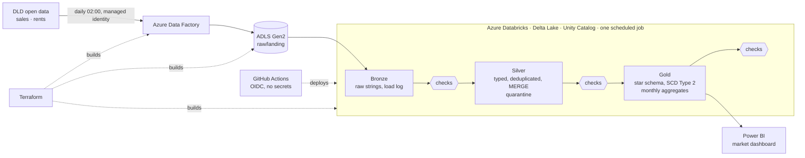

# Dubai Property Data Platform

[](https://github.com/salmantariq596/dubai-property-data-platform/actions/workflows/ci.yml)

**An Azure lakehouse that turns official Dubai Land Department (DLD) sales and rental records into a market dashboard, refreshed daily, tested end to end, and built entirely from code.**

**The question it answers:** *Where in Dubai are prices rising fastest, what does a square foot cost by area and property type, and what rental yield can an investor expect?*

> **Status:** all ten modules are built, tested and merged, and the pipeline and dashboard run end to end on real DLD data (1.38 million sales, 95,561 rent contracts) on Databricks Free Edition. The Azure deployment is next; figures that need it are shown as `_`, never estimated.

## Demo

| | |
|---|---|
| 📊 Dashboard | 4 pages on real data: [Market overview](docs/img/dashboard-market-overview.png) · [Area deep-dive](docs/img/dashboard-area-deep-dive.png) · [Off-plan vs ready](docs/img/dashboard-offplan-vs-ready.png) · [Rental yield](docs/img/dashboard-rental-yield.png) ([design](docs/dashboard.md)) |
| 📄 PDF export | [DubaiPropertyMarket.pdf](powerbi/DubaiPropertyMarket.pdf) |
| 🎥 3-minute demo | _after the Azure deployment_ |



<details>
<summary>The other three pages</summary>





</details>

## Architecture



A failed check stops the run before the next layer, so the dashboard keeps the last good data. Every service reaches the lake and Databricks through a managed identity: there are no keys, passwords or tokens anywhere. How each layer works: [architecture](docs/architecture.md).

## In numbers

| | |
|---|---|
| Records processed | 1,382,848 registered sales and 95,561 Ejari rent contracts |
| Years covered | Sales 2000 to 2 November 2026; rents October 2026 |
| Full-history run | About 4 minutes, bronze to gold with every check, on Databricks Free Edition (serverless); a re-run with nothing new takes about 1 minute |
| Daily run on Azure | _ minutes, about _ USD |
| Query time after `OPTIMIZE` + liquid clustering | _ % faster ([performance](docs/performance.md)) |
| Tests | 514: 423 unit, 91 Spark and integration, 98% coverage, all in CI |
| Data quality checks | 25 between the layers, every result recorded |
| Infrastructure | 5 Terraform stacks, 0 secrets |

## Tech stack

| Layer | Tool | Why this tool |
|---|---|---|
| Storage | Azure Data Lake Storage Gen2 | Hierarchical namespace for `abfss://` paths, one container per medallion layer |
| Ingestion and scheduling | Azure Data Factory | Moves files from a web source on a schedule with retries; the most-listed orchestrator in Gulf data roles |
| Processing | Azure Databricks, PySpark | Scales from one year of data to the full DLD history without code changes |
| Table format | Delta Lake | ACID writes, MERGE for idempotent loads, time travel to recover, OPTIMIZE and liquid clustering |
| Governance | Unity Catalog | Catalog, schemas and volumes, with storage reached through a managed identity |
| Data quality | Own framework: SQL checks + `dq_results` | 25 rules readable in one file; quarantine, warn or fail per rule |
| BI | Power BI (model as TMDL code) | The region's dominant BI tool; the model is reviewed and tested like code |
| Infrastructure as code | Terraform | The whole platform rebuilt from scratch with a few `apply`s |
| CI/CD | GitHub Actions, Databricks Asset Bundles, OIDC | Every change tested; merges deploy themselves without stored secrets |

## Data model

A Kimball star: two facts sharing conformed dimensions, plus one monthly aggregate for the medians and yields that DAX cannot sum. Full diagram, grains and measures: [gold model](docs/gold_model.md).

| Table | Grain |
|---|---|
| `fact_sales` | One registered sale (mortgages and gifts excluded) |
| `fact_rents` | One Ejari rental contract |
| `dim_area` | One version of one area (SCD Type 2: renames keep history) |
| `dim_date`, `dim_property_type`, `dim_project` | One day / type and sub-type / project |
| `agg_area_monthly` | One area × property type × month, plus an "All types" row |

## Design decisions and trade-offs

Each decision has a record in [docs/adr/](docs/adr/) with the alternatives considered.

| Decision | Instead of | Why | ADR |
|---|---|---|---|
| Build and test locally and on Databricks Free Edition first | Developing on Azure from day one | Fast feedback at no cost; Azure only once the code is proven | [0001](docs/adr/0001-local-first-development.md) |
| Auto Loader with idempotent `foreachBatch` writes | ADF copying straight into tables | File tracking, schema evolution and replay-safe writes inside the lakehouse; ADF only moves files | [0002](docs/adr/0002-bronze-ingestion-design.md) |
| Every bronze column a string | Inferring types on read | Casting is a business decision made in silver, where failures are quarantined instead of lost | [0002](docs/adr/0002-bronze-ingestion-design.md) |
| Quarantine bad rows; fail only when the next layer would be wrong | Failing the run on any bad row | One bad row must not block a million good ones; a mostly bad load must | [0003](docs/adr/0003-silver-cleaning-design.md), [0005](docs/adr/0005-data-quality.md) |
| MERGE on the business key, latest ingested wins | Overwrite or append | Re-runs and replays change nothing; older data never overwrites newer | [0003](docs/adr/0003-silver-cleaning-design.md) |
| Hash surrogate keys | Identity columns | Same input, same key: dimensions rebuild without re-keying facts | [0004](docs/adr/0004-gold-star-schema.md) |
| SCD Type 2 for areas only | Type 2 everywhere | Area names are what changes and what reports need historically; the rest stays Type 1 | [0004](docs/adr/0004-gold-star-schema.md) |
| Liquid clustering by date | Partitioning by month | Healthy file sizes without choosing a partition column up front | [0004](docs/adr/0004-gold-star-schema.md) |
| One Databricks job chaining the layers | One ADF activity per layer | One cluster start per run; the whole chain visible in one place | [0008](docs/adr/0008-orchestration.md) |
| Backfill lands days, then runs the job once | One job run per day of history | Incremental loads make three years one run, not about 1,000 | [0008](docs/adr/0008-orchestration.md) |
| Managed identities and OIDC everywhere | Keys, personal access tokens, client secrets | Nothing to store, rotate or leak | [0007](docs/adr/0007-azure-infrastructure.md), [0009](docs/adr/0009-cicd-and-monitoring.md) |
| Power BI model as tested TMDL | A model clicked together in Desktop | Reviewable diffs; CI catches a gold change that would break the report | [0006](docs/adr/0006-power-bi-model.md) |

## Data quality

Three responses, each where it fits:
- a broken **row** is quarantined in silver with the rule it broke and its raw values;
- something odd but usable is a **WARN**;
- anything that would make the next layer wrong is a **FAIL**: the run stops, gold is not rebuilt, and an alert goes out.

25 checks run between the layers: keys, dates, positive values, quarantine rate, row-count change against the previous load, gold reconciliation with silver, and dimension integrity. Every result is recorded in `quality.dq_results`. Rule catalogue: [data quality](docs/data_quality.md).

## Cost

| Run | Cost |
|---|---|
| Full history and daily runs on Databricks Free Edition | Free |
| Daily on Azure | _ (measured after deployment) |
| Month on Azure (30 daily runs + storage) | _ |

Controls built in:
- a budget alert set up before anything else;
- one small single-node job cluster shared by all steps;
- incremental loads;
- backfill in one job run;
- schedules deployed off;
- a timeout and a single run at a time;
- `terraform destroy` when idle.

Measured from Databricks system billing and Azure Cost Management: [cost](docs/cost.md).

## How to run it

**New here?** [Getting started](docs/getting_started.md) goes from a fresh clone to the dashboard on real data, step by step: what to install, which accounts to create, what each step should print, and the traps found along the way.

**Locally, in minutes** (Python 3.10+):

```bash
git clone https://github.com/salmantariq596/dubai-property-data-platform.git
cd dubai-property-data-platform
make setup                         # virtualenv, dev dependencies, pre-commit hooks
make test-fast                     # unit tests, no Spark needed
python tools/make_sample_gold.py   # synthetic gold tables to open the Power BI report with
```

`make setup-spark && make test` adds the Spark and Delta tests (needs Java 17+; on Windows use WSL). CI runs everything on every pull request.

**On Databricks Free Edition:** clone the repo as a Git folder, run `notebooks/00_setup_unity_catalog`, upload a DLD file to the landing volume, and run `notebooks/06_run_pipeline`. Or deploy the job with `databricks bundle deploy` (target `dev`, serverless).

**On Azure, the full platform:**

```bash
terraform -chdir=infra/bootstrap apply       # budget alert, Terraform state storage
terraform -chdir=infra/platform apply        # lake, Databricks, Key Vault, Data Factory
terraform -chdir=infra/unity-catalog apply   # catalog, schemas, volumes
databricks bundle deploy -t azure            # the daily job and the health check
terraform -chdir=infra/orchestration apply   # Data Factory pipelines and the daily trigger
terraform -chdir=infra/cicd apply            # GitHub OIDC identity: merges deploy themselves
```

Step-by-step, with the backend and variable files each stack needs: [infra](infra/README.md), [orchestration](docs/orchestration.md), [CI/CD](docs/cicd.md). When something fails: [runbook](docs/runbook.md).

## What the data says

From the dashboard on real data. Prices and rents are for homes (residential apartments and villas), outliers excluded. Method and caveats: [dashboard insights](docs/dashboard.md#insights).

1. **Activity cooled; prices kept rising.** Registered sales rose from 33,102 in 2020 to a record 214,803 in 2025. In 2026 to 2 November they ran 23% below the same period of 2025, yet the median price per sqft of homes was 5.6% higher over the last 12 months than the 12 before (1,738 vs 1,646 AED), and off-plan reached 67% of sales.
2. **Off-plan costs about a quarter more than ready, not two thirds.** Like for like over the last 12 months: apartments 1,803 vs 1,434 AED per sqft (+26%), villas 1,822 vs 1,480 (+23%). A plain all-years comparison says +64%, because ready sales reach back to cheaper years and include more villas.
3. **Yields fall as prices rise: from 10.5% to 3.5%.** Citywide gross yield on homes was 5.3% in October 2026 (median rent AED 69,458, median ready price AED 1.24 million): 10.5% in Me'Aisem First (Dubai Production City), 6.7% in JVC, 5.8% in Downtown, 5.25% in Dubai Marina, 3.5% on Palm Jumeirah.

## Lessons learned

- **Real data finds what synthetic data cannot.** The first run on 1.38 million real sales, from a fresh clone, found more than a dozen problems that 400 passing tests had not: a dependency missing from a clean install, a notebook widget Databricks rejects, a command serverless compute forbids, a profiler that read a building named "1-1-2" as a date, and measures that were correct on paper but wrong on real data. Each fix came with a test.
- **A median comparison is only as good as what it compares.** Off-plan against ready over all years said 64%; like for like (same months, same property type) it is 26%. Rental yield against an all-years sale price said up to 14.6% in one area; against ready sales in the same month and type, the highest is 10.5%.
- **Test what production runs, not something close to it.** Local tests fell back to Parquet when Delta was unavailable, which hid a write that used the wrong table format; the first CI run with Delta caught it. CI now refuses to run without Delta.
- **Lazy plans grow.** Tests that chained silver, dimensions, facts and aggregates without materialising anything ran out of driver memory. The pipeline never had the problem, because it writes each layer to a table, and the tests now checkpoint the same way.
- **Every tool has its own type system.** Power BI imports source decimals as floating point. The test that keeps the Power BI model in step with gold now compares types as Power BI sees them, not as Spark writes them.
- **Silence is a failure mode.** Alerts fire when something runs and fails, not when nothing runs at all. A daily health check reports STALE when the last complete run is more than 26 hours old.
- **Rules as data pay off before the data arrives.** The cleaning rules, thresholds and mappings live in plain Python files, written against the expected schema, so adapting to the real files is an edit to one reviewed file, not a hunt through Spark code.
- **Identities instead of secrets is less work, not more.** No key or token was ever created, so there is nothing to rotate, store in Key Vault, or leak in a public repository.

## What I would do next

- Cross-check monthly medians against the official DLD Residential Sale Price Index, and publish the gap.
- Net rental yield, using service charges and typical vacancy.
- Load the DLD projects and developers datasets to fill `dim_project` (developer, status).
- Incremental MERGE into the gold facts, worthwhile once volumes or refresh frequency grow.
- Rebuild the gold layer and report in Microsoft Fabric (Lakehouse + Power BI Direct Lake).

## Repository layout

```
├── src/dubai_property/   # all pipeline logic, tested
│   ├── profiling/  bronze/  silver/  gold/  quality/
│   ├── orchestrate.py    # the pipeline, and one job step at a time
│   ├── monitoring.py     # views over the pipeline's own logs; health.py: one status
│   └── config.py         # datasets, paths, table names
├── notebooks/            # thin notebooks that call src/ (00 setup … 09 monitoring)
├── tests/                # unit/, spark/, integration/, fixtures/
├── infra/                # Terraform: bootstrap, platform, unity-catalog, orchestration, cicd
├── databricks.yml        # Databricks Asset Bundle (jobs in resources/)
├── adf/                  # Data Factory pipelines (JSON)
├── powerbi/              # Power BI project: model (TMDL), report, theme
├── tools/                # synthetic sample data for the report
└── docs/                 # architecture, decisions, runbooks, data dictionary, cost
```

## Documentation

| Topic | |
|---|---|
| From clone to dashboard, step by step | [getting started](docs/getting_started.md) |
| How each layer works | [architecture](docs/architecture.md) |
| Design questions, answered | [design Q&A](docs/design_qa.md) |
| Data | [sources](docs/data_sources.md) · [dictionary](docs/data_dictionary.md) · [business questions](docs/business_questions.md) |
| Model and dashboard | [gold model](docs/gold_model.md) · [dashboard](docs/dashboard.md) · [Power BI](powerbi/README.md) |
| Running it | [infra](infra/README.md) · [orchestration](docs/orchestration.md) · [CI/CD](docs/cicd.md) · [runbook](docs/runbook.md) · [cost](docs/cost.md) |
| Decisions | [ADRs 0001–0009](docs/adr/) |
| History | [CHANGELOG](CHANGELOG.md) |

## Roadmap

| Module | Scope | Code | Live |
|---|---|---|---|
| 1 | Repo skeleton, data profiling, data dictionary, business questions | ✅ | ✅ v0.1 |
| 2 | Bronze ingestion with Auto Loader and load log | ✅ | ✅ v0.2 |
| 3 | Silver: typing, dedup, area mapping, MERGE, quarantine | ✅ | ✅ v0.3 |
| 4 | Gold star schema, SCD Type 2, monthly aggregates, OPTIMIZE | ✅ | ✅ v0.4 |
| 5 | Data quality framework and integration tests | ✅ | ✅ v0.5 |
| 6 | Power BI dashboard | ✅ | ✅ v0.6: real data, PDF, insights |
| 7 | Azure infrastructure with Terraform | ✅ | apply, rebuild proof |
| 8 | Data Factory orchestration, Asset Bundles | ✅ | deploy, backfill, schedule |
| 9 | CI/CD deploy, monitoring, runbook, cost | ✅ | first deploy, measured cost |
| 10 | Documentation and launch | ✅ | demo video |

## Data and license

Official DLD open data only; no listing sites are scraped, because listing prices are asking prices and DLD records are registered prices. Raw data is never committed. Code under the MIT license ([LICENSE](LICENSE)).

Sales data: Dubai Real Estate Data (dubairealestatedata.com), based on Dubai Land Department open data, CC BY 4.0. Rent data: Dubai Land Department open data; Ejari extract compiled by Daemon Data, CC BY 4.0. Where each dataset comes from, and why: [data sources](docs/data_sources.md).
