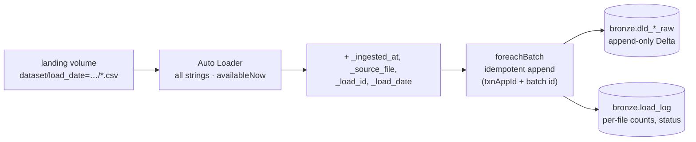
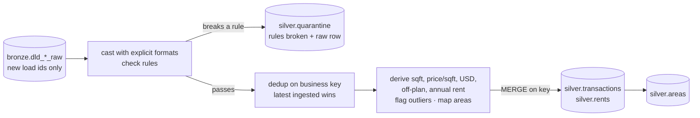
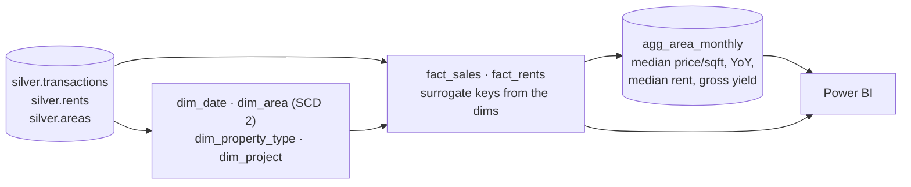
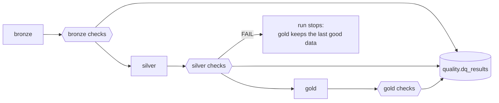
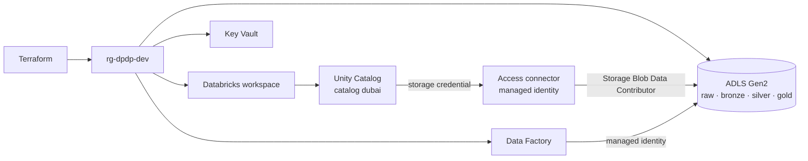

# Architecture, layer by layer

How each layer works and why, with links to the decision record and runbook for each. The overview is in the [README](../README.md).

## Bronze: load every file exactly once

- **Re-runs are safe.** Auto Loader's checkpoint skips files already loaded, and idempotent writes cover a crash between writing and checkpointing.
- **Nothing is changed or lost.** Every column stays a string, `delta.appendOnly` blocks deletes and updates, and malformed values go to `_rescued_data`.
- **Every run is accounted for.** Each file is counted back after writing; empty and failed runs are logged too.

Design reasoning: [ADR 0002](adr/0002-bronze-ingestion-design.md). Operations: [bronze runbook](runbook_bronze.md).

## Silver: typed, trustworthy, one row per key

- **Bad data is kept, not lost.** A row that fails a cast or a rule goes to `silver.quarantine` with the rules it broke and its raw values.
- **Outliers are flagged, not deleted.** Zero sizes and prices per sqft outside 100–20,000 AED stay in silver with `outlier_reason`.
- **One area, one name.** English, Arabic and misspelled area names map to one `area_key`; Arabic-only rows get their English name.
- **Re-runs are safe.** Only new bronze loads are processed, and MERGE on the business key means a repeat changes nothing and old data never overwrites newer data.

Design reasoning: [ADR 0003](adr/0003-silver-cleaning-design.md). Operations: [silver runbook](runbook_silver.md).

## Gold: a star schema for Power BI

- **Clear grain.** `fact_sales` is one registered sale, `fact_rents` one Ejari contract; `agg_area_monthly` is one area × property type × month.
- **History kept.** `dim_area` is SCD Type 2: a sale keeps the area name it had on its date, and the aggregate reports today's name.
- **No lost rows.** Missing areas, types or projects point at an Unknown row (`-1`).
- **Yield you can trust.** Gross yield is published only when both medians rest on at least 10 records; outliers and multi-unit contracts are left out of medians.

Model diagram, grains and measures: [gold model](gold_model.md). Design reasoning: [ADR 0004](adr/0004-gold-star-schema.md). Timings: [performance](performance.md).

## Data quality: bad data stops before the dashboard

- **The right response for each problem.** A bad row is quarantined in silver. Something odd but usable is a WARN. Anything that would make the next layer wrong is a FAIL and stops the run.
- **25 checks, each one SQL query** with WARN and FAIL thresholds: keys, dates, positive values, quarantine rate, row-count change against the previous load, gold reconciliation with silver, dimension integrity.
- **Every result recorded** in `dq_results`, before anything fails: rule, table, rows checked and failed, load id.
- **Tested end to end.** Integration tests run bronze to gold on both fixtures, and prove that a mostly broken load is stopped at silver with gold untouched.

Rule catalogue and what to do when a check fails: [data quality](data_quality.md). Design reasoning: [ADR 0005](adr/0005-data-quality.md).

## Dashboard

Four pages in Power BI: Market overview, Area deep-dive, Off-plan vs ready, Rental yield. The semantic model is code (TMDL), tested against gold in CI so a gold change cannot silently break the report. One parameter switches between a Databricks SQL warehouse and exported Parquet files.

Page designs: [dashboard](dashboard.md). Setup: [powerbi/](../powerbi/README.md). Design reasoning: [ADR 0006](adr/0006-power-bi-model.md). *Screenshots follow once real data is loaded; until then the report runs on synthetic sample data (`tools/make_sample_gold.py`).*

## Infrastructure: Azure from code, no keys

- **Three stacks:** `bootstrap` (budget alert and state storage), `platform` (Azure resources) and `unity-catalog` (catalog, schemas, volumes), applied in that order.
- **No keys anywhere.** Storage account keys are disabled; Unity Catalog and Data Factory reach the lake through managed identities with one role each.
- **Checked on every pull request:** `terraform fmt` and `validate` run in CI, and unit tests fail if a security choice drifts.

How to deploy, rebuild and keep costs down: [infra/](../infra/README.md). Design reasoning: [ADR 0007](adr/0007-azure-infrastructure.md).

## Orchestration: a daily run nobody has to start

Every day at 02:00 Dubai time, Data Factory lands the new DLD files in the lake, then starts one Databricks job: bronze → checks → silver → checks → gold → checks.

- **Defined in the repo:** the job is a Databricks Asset Bundle; the Data Factory pipelines are JSON deployed by Terraform, and tests check every reference in them.
- **Every step logs itself** to `quality.pipeline_runs`: SUCCESS with a summary, or FAILED with the error.
- **Failures alert:** an email from Databricks and an optional Teams or Slack webhook from Data Factory.
- **No secrets:** Data Factory calls Databricks and the lake with its managed identity.
- **Backfill in one job run:** `pl_backfill` lands a date range day by day, then runs the job once. The pipeline is incremental, so three years of history is one run.

How to deploy, run, backfill and recover: [orchestration](orchestration.md). Design reasoning: [ADR 0008](adr/0008-orchestration.md).

## Operations: deploy, watch, recover

- **CI on every pull request:** lint, unit tests, Spark tests in parallel groups, `terraform validate`, `databricks bundle validate`.
- **Deploy on merge to `main`:** GitHub signs in to Azure with OIDC, so there is no stored secret, and deploys the Databricks bundle through a `production` environment. [How a change reaches production](cicd.md).
- **Monitoring from the pipeline's own logs:** last run per step, rows per load, failure and quality trends, quarantine rate, job cost from Databricks billing (`notebooks/09_monitoring`).
- **One health status:** OK / WARN / STALE / FAILED. A daily health check alerts even when the pipeline did not run at all.
- **When something fails:** [runbook](runbook.md). **What it costs and why it stays low:** [cost](cost.md). Design reasoning: [ADR 0009](adr/0009-cicd-and-monitoring.md).
