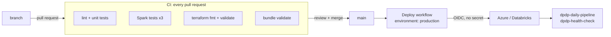

# CI/CD: how a code change reaches production

Design: [ADR 0009](adr/0009-cicd-and-monitoring.md).



## Walk-through

1. **Branch and change.** For example, a new rule in `silver/rules.py`. Run `make test-fast` locally: unit tests in seconds.
2. **Open a pull request.** CI runs in parallel:
   - lint and unit tests (no Spark), about a minute;
   - Spark and Delta tests in three groups on separate runners;
   - `terraform fmt` and `validate` on every Terraform stack;
   - `databricks bundle validate` against the real workspace, once Azure is set up;
   - combined coverage.

   A red check blocks the merge.
3. **Review and merge.** Merging to `main` starts the **Deploy** workflow.
4. **Deploy.** The workflow signs in to Azure with an OIDC token that GitHub issues for this run only. Entra ID trusts it through the federated credential in `infra/cicd`, for the `production` environment of this repository only. It then validates again and runs `databricks bundle deploy -t azure`. The job definitions and the notebooks are updated in the workspace (`/Workspace/Shared/.bundle/...`).
5. **Next scheduled run uses the new code.** At 02:00 Data Factory starts the job, which now runs the new version. If that run fails, the alerts and `quality.pipeline_runs` say so, and the fix goes through the same path.

**Infrastructure** changes (`infra/`) are validated in CI but applied by hand with `terraform apply`, after reading the plan. Infrastructure changes are rarer and riskier than code changes, and a human should read what will be created or destroyed.

**Data Factory** pipelines (`adf/pipeline/`) are tested in CI and deployed with `terraform apply` in `infra/orchestration`.

## Set up (once, after the platform is deployed)

```bash
# 1. The deploy identity: Entra app with federated credentials, workspace admin, catalog access
cd infra/cicd
cp example.tfvars terraform.tfvars      # subscription_id, state_storage_account, github_repository
cp backend.example.hcl backend.hcl      # key = "cicd.tfstate"
terraform init -backend-config=backend.hcl
terraform apply
terraform output                        # the four values for step 2
```

2. In GitHub, *Settings → Environments → New environment* `production`. Optionally add yourself as a required reviewer, so every deploy waits for approval.
3. *Settings → Secrets and variables → Actions → Variables*: add `AZURE_CLIENT_ID`, `AZURE_TENANT_ID`, `AZURE_SUBSCRIPTION_ID` and `DATABRICKS_HOST` from the outputs. They are **variables**, not secrets: none of them grants access on its own.

From then on, `bundle validate` runs on pull requests and every merge to `main` deploys. Until the variables exist, both jobs are skipped, so CI stays green before Azure is set up.

## Why no secrets

A personal access token or client secret in GitHub would be long-lived, tied to a person or an app, and would have to be rotated and protected. With OIDC federation nothing is stored:

- each token lives for minutes;
- it is valid only for this repository and environment;
- it is useless anywhere else.

A test fails if any workflow refers to `secrets.`.
