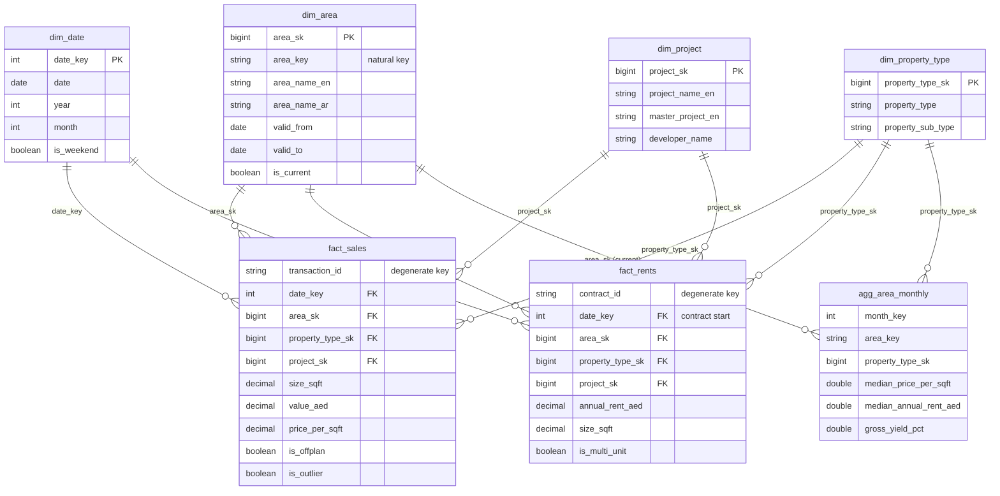

# Gold model

A Kimball star schema: two fact tables sharing conformed dimensions, plus one monthly aggregate for the dashboard. Built by `notebooks/04_gold_star_schema` from silver. Design: [ADR 0004](adr/0004-gold-star-schema.md).

## Grain

| Table | Grain | Built from |
|---|---|---|
| `fact_sales` | One registered sale (`trans_group_en` = Sales; mortgages and gifts excluded) | `silver.transactions` |
| `fact_rents` | One Ejari rental contract, dated by its start date | `silver.rents` |
| `dim_date` | One day, 2000-01-01 to 2030-12-31 | generated |
| `dim_area` | One version of one area (SCD Type 2) | `silver.areas` |
| `dim_property_type` | One property type and sub-type, shared by sales and rents | both silver tables |
| `dim_project` | One project, matched across datasets by English name | both silver tables |
| `agg_area_monthly` | One area × property type × month, plus an "All types" row per area and month | the facts |

## Keys

- **Surrogate keys** are `xxhash64` of the natural key (for `dim_area`, of the area key and the version's start date). The same input always gives the same key, so rebuilding a dimension never re-numbers it.
- **`-1` Unknown** exists in every dimension except `dim_date`. Facts with a missing or unmapped area, type or project point at it, so inner joins never drop rows.
- **`0` All types** in `dim_property_type` is used only by `agg_area_monthly`, for the roll-up across types. Medians cannot be added up, so the roll-up is computed from the facts, not from the per-type rows.
- **`date_key`** is `yyyymmdd` as an integer.

## dim_area: SCD Type 2

| Change | What happens |
|---|---|
| New area | One version, valid from 1900-01-01 to 9999-12-31, so older facts find it too |
| Name changed | Current version closes the day before the run date; a new version opens on the run date |
| Changed twice in one day | The day's version is updated; no one-day rows |
| Area no longer delivered | Kept as is: old facts still point at it |
| No change | Nothing; a re-run with the same data changes no rows |

Facts join the version **valid on their own date**. A sale from January 2024 keeps the name the area had then, even after a rename. `agg_area_monthly` reports every month under the area's **current** name, so trends are not split by renames.

## Measures

| Measure | Definition | Where |
|---|---|---|
| Median price per sqft | Median of `price_per_sqft`, outliers excluded | `agg_area_monthly.median_price_per_sqft` |
| YoY change | This month's median price per sqft vs the same month a year earlier, % | `median_price_per_sqft_yoy_pct` |
| Median annual rent | Median of `annual_rent_aed`, multi-unit contracts excluded | `median_annual_rent_aed` |
| Gross rental yield | Median annual rent / median sale price × 100, same area, type and month; only when both rest on at least 10 records | `gross_yield_pct` |
| Off-plan share | `offplan_sales_count / sales_count` | computed in Power BI |
| Sales volume and value | `sales_count`, `sales_value_aed` (outliers included) | `agg_area_monthly`, `fact_sales` |

## Running and re-running

- Facts, aggregates and every dimension except `dim_area` are rebuilt from silver on each run, so a run is always safe to repeat.
- `dim_area` carries history. Never overwrite or delete it by hand: a rebuild from scratch would date every name from 1900 and lose renames.
- Run gold after silver. With no silver tables it reports `NO_SILVER` and writes nothing.
