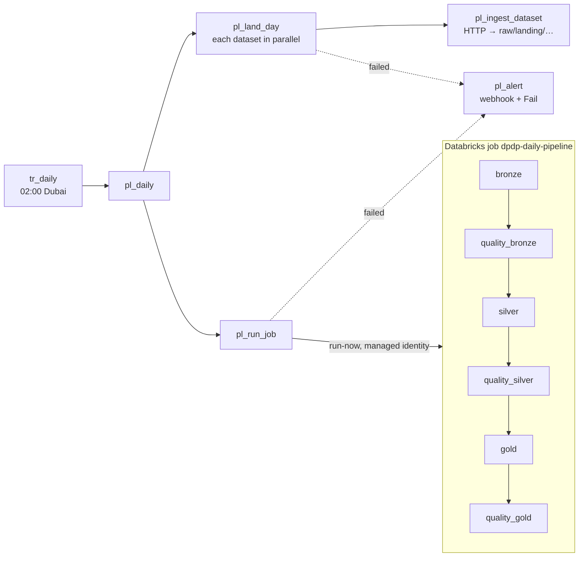

# Orchestration: Data Factory and the Databricks job

Every day at 02:00 Dubai time, Data Factory lands the day's DLD files in the lake and starts the Databricks job that runs bronze, silver and gold, with data quality checks between them. Design: [ADR 0008](adr/0008-orchestration.md).



## The pieces

| Piece | Where | What it does |
|---|---|---|
| `pl_ingest_dataset` | `adf/pipeline/` | Copies one source file byte for byte to `raw/landing/<dataset>/load_date=<date>/<dataset>.csv`, the Unity Catalog volume `dubai.raw.landing` |
| `pl_land_day` | `adf/pipeline/` | Runs `pl_ingest_dataset` for every dataset of one day, in parallel |
| `pl_run_job` | `adf/pipeline/` | Starts the Databricks job, checks it every minute until it finishes, alerts and fails unless it succeeded |
| `pl_alert` | `adf/pipeline/` | Posts the message to the alert webhook (Teams or Slack) if one is set, then fails with it |
| `pl_daily` | `adf/pipeline/` | Lands today's files, then runs the job. Started by `tr_daily` |
| `pl_backfill` | `adf/pipeline/` | Lands every day in a date range, then runs the job **once** |
| `dpdp-daily-pipeline` | `resources/jobs.yml` (Asset Bundle) | Six tasks, each running `notebooks/08_job_step.py` with its step; emails on failure |
| `quality.pipeline_runs` | written by every step | One row per step per run: SUCCESS with a summary, or FAILED with the error |

## Deploy

Prerequisites: the `bootstrap`, `platform` and `unity-catalog` stacks are applied ([infra/README.md](../infra/README.md)), and the [Databricks CLI](https://docs.databricks.com/dev-tools/cli/install.html) is installed.

```bash
# 1. The Databricks job, from the repo root
export DATABRICKS_HOST="https://$(terraform -chdir=infra/platform output -raw databricks_workspace_url)"
databricks bundle deploy -t azure --var="alert_email=you@example.com"
databricks bundle summary -t azure          # note the job id

# 2. Data Factory pipelines, datasets and the (inactive) daily trigger
cd infra/orchestration
cp example.tfvars terraform.tfvars          # job id, DLD source URLs, optional webhook
cp backend.example.hcl backend.hcl          # key = "orchestration.tfstate"
terraform init -backend-config=backend.hcl
terraform apply
```

**On Databricks Free Edition** (no Data Factory): deploy the job with `databricks bundle deploy` (target `dev`, serverless) and run or schedule it in the Databricks UI. Upload files to the landing volume by hand.

## Run

1. **First run, by hand:** in Data Factory Studio, open `pl_daily` → *Debug* (or *Add trigger → Trigger now*). Leave `load_date` empty for today.
2. Watch it in *Monitor*: the pipeline lands the files, then waits on the Databricks job. Follow the job in Databricks: *Workflows → dpdp-daily-pipeline*.
3. **Then switch the schedule on:** `enable_schedule = true` in `terraform.tfvars`, `terraform apply`.

### Backfill

Run `pl_backfill` with `start_date` and `end_date` (inclusive, `yyyy-MM-dd`). It lands one day at a time, then runs the Databricks job once. The pipeline is incremental, so bronze picks up every new file in that single run: there is no need to run the job once per day of history.

### Source URLs

`source_urls` maps each dataset to its download path under `source_base_url`. A path containing `{load_date}` gets the load date, for sources that publish one file per day; a fixed path downloads the same (full) file each run, and bronze keeps every load separately. **Confirm the real paths on the DLD open data portal and record them in [data_sources.md](data_sources.md) before the first run.**

## When something fails

| Fails at | What you see | What is recorded | Re-run |
|---|---|---|---|
| Landing a file (source down, wrong URL) | `pl_daily` fails; webhook alert | Data Factory run history | Run `pl_daily` for that `load_date` |
| A Databricks step | Task fails, later tasks are skipped; email from Databricks; webhook from `pl_run_job` | `quality.pipeline_runs` (FAILED, error); bronze also writes `bronze.load_log` | Repair the run in Databricks, or run `pl_daily` again |
| A FAIL data quality check | `quality_*` task fails; gold is not rebuilt | `quality.dq_results`, `quality.pipeline_runs` | Fix the cause (silver runbook), then re-run |

```sql
-- What happened last night
SELECT step, status, duration_seconds, summary, error_message
FROM dubai.quality.pipeline_runs
WHERE started_at >= current_date() - INTERVAL 1 DAY
ORDER BY started_at;
```

### What if silver fails halfway, and you re-run?

(The plan's checkpoint question.) Nothing is lost or doubled:

- **Bronze is already done.** Its checkpoint and the load log say which files were loaded. On the re-run, bronze finds no new files and logs `NO_NEW_FILES`.
- **Silver starts again from the same loads.** It processes every bronze `_load_id` not yet in `silver.processed_loads`, and that record is written last. Loads the failed run had already merged are merged again: MERGE on the business key makes that a no-op, and quarantine MERGEs on a row hash.
- **Gold was never touched.** The job stopped before it, so the dashboard kept the last good data. Gold rebuilds from silver on the re-run.
- **The failure stays on record.** `quality.pipeline_runs` keeps the FAILED row and its error next to the successful re-run.

So the recovery is always the same: fix the cause, run it again.
